# Домашка под контролем

**Веб-приложение, которое помогает школьнику записывать домашние задания, планировать их выполнение и не забывать о сроках.**

👉 **Открыть приложение:** https://komissar-dev.github.io/Dzhasimov-homework/

Индивидуальный проект · 8 класс · 2026

| | |
|---|---|
| **Автор** | Джасимов Арман, ученик 8 «Б» класса |
| **Руководитель** | Ковальская Елена Андреевна |
| **Школа** | ГБОУ школа № 206, Санкт-Петербург |

📎 Материалы: [презентация (PPTX)](docs/presentation.pptx) · [доклад (DOCX)](docs/report.docx) · [инструкция по тестированию (DOCX)](docs/testing-guide.docx)

---

## Паспорт проекта

### Тема
«Домашка под контролем»: создание веб-приложения для планирования домашних заданий.

**Сценарий:** продуктовый проект: придумать и сделать полезный продукт, который решает реальную проблему.

### Актуальность
Выбранная тема актуальна, потому что у школьников с каждым годом растёт учебная нагрузка, а времени на всё не хватает. Мой проект поможет ученикам вовремя выполнять домашние задания и меньше нервничать перед сроками.

### Проблема
Школьники забывают о домашних заданиях и откладывают их на последний момент:
- задания записаны в разных местах: в тетради, в чате класса, в электронном дневнике;
- электронный дневник показывает задания, но не напоминает о них заранее;
- большие задания (доклады, проекты) откладываются до последнего вечера.

### Цель
Создать веб-приложение, которое помогает школьникам записывать домашние задания, планировать их выполнение и получать напоминания о сроках.

**Задачи:**
1. Провести опрос одноклассников: как они записывают и планируют домашние задания.
2. Изучить основы HTML, CSS и JavaScript.
3. Спроектировать архитектуру приложения.
4. Написать и протестировать приложение.
5. Проверить гипотезу на группе учеников.

### Целевая аудитория
| Кто | Тип | Чем полезно приложение |
|---|---|---|
| Ученики 5–9 классов | основная | Много предметов и заданий; почти у всех есть смартфон с браузером |
| Родители | дополнительная | Ребёнок учится самостоятельно и без вечерних авралов |
| Учителя | дополнительная | Задания сдают вовремя |

### Продуктовый результат
Работающее веб-приложение. Оно открывается в любом браузере на телефоне или компьютере, ничего не нужно устанавливать и не нужно регистрироваться.

Что умеет:
1. **Записать задание**: предмет, что задано и к какому дню (кнопки «Завтра», «Пн»…«Пт», «Через неделю» или календарь).
2. **Списки** во вкладках «К завтра», «Все», «Сделано».
3. **Напоминание** каждый день в выбранное время: оранжевая плашка и уведомление браузера.
4. **Шаги для больших заданий**: свои шаги или «Разбить на 4 шага».
5. **Отметка «сделано»**: одним нажатием.
6. **Итоги недели**: сколько заданий всего, сделано вовремя, с опозданием и просрочено.

### Архитектура

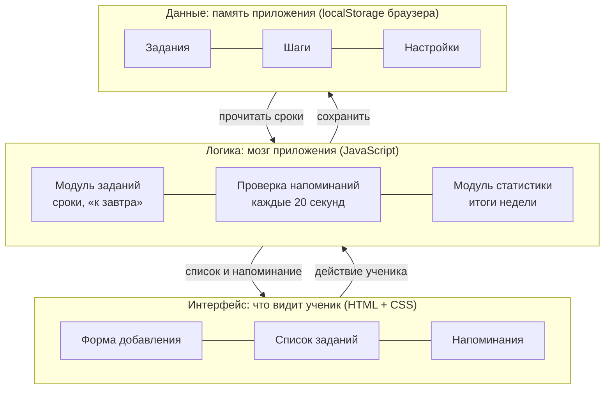

| Уровень | Файлы | Что делает |
|---|---|---|
| Интерфейс | [`index.html`](index.html), [`style.css`](style.css), [`js/app.js`](js/app.js) | страница, кнопки, список, плашка напоминания |
| Логика | [`js/logic.js`](js/logic.js) | даты и сроки, список «к завтра», итоги недели, когда напоминать |
| Данные | [`js/storage.js`](js/storage.js) | хранит задания, шаги и настройки в браузере (localStorage) |

[`manifest.json`](manifest.json) и [`sw.js`](sw.js) позволяют установить приложение на телефон («Добавить на главный экран») и открывать его без интернета.

### Гипотеза
Если ученики будут записывать домашние задания в веб-приложение и получать напоминания, то они станут реже забывать о заданиях и реже делать их в последний вечер.

**Как проверить:**
| Этап | Что делаем | Что считаем |
|---|---|---|
| 1. Без приложения, 2 недели | [10] учеников учатся как обычно | Забытые задания и задания «в последний вечер» |
| 2. С приложением, 2 недели | Те же ученики пользуются приложением | Те же показатели |
| 3. Анкета | Спрашиваем, удобно ли приложение | Оценка удобства от 1 до 5 |

Гипотеза подтвердится, если на втором этапе забытых заданий станет меньше, чем на первом. Результат: *[заполнить после эксперимента]*.

---

## Презентация

Полная версия: [presentation.pptx](docs/presentation.pptx)

| | |
|---|---|
| 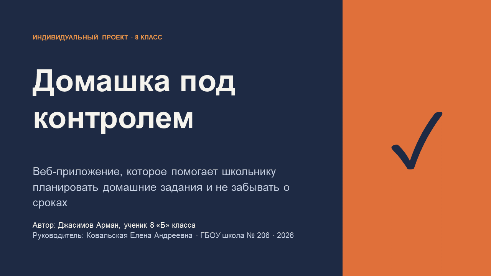 | 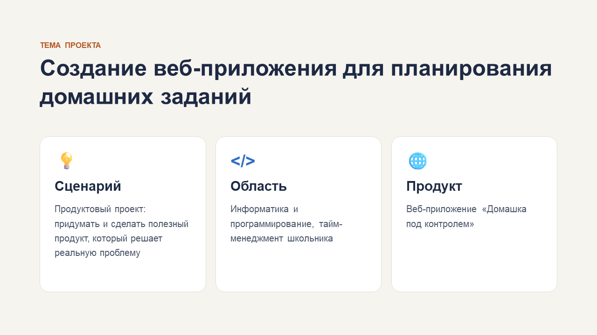 |
|  | 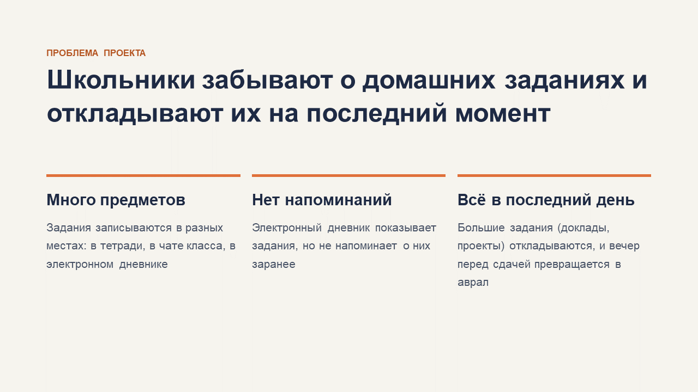 |
| 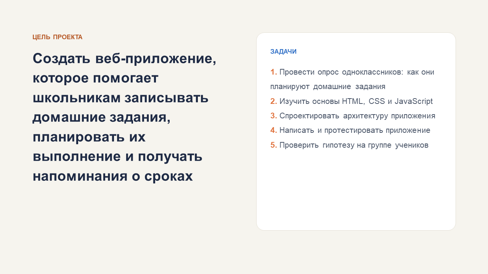 | 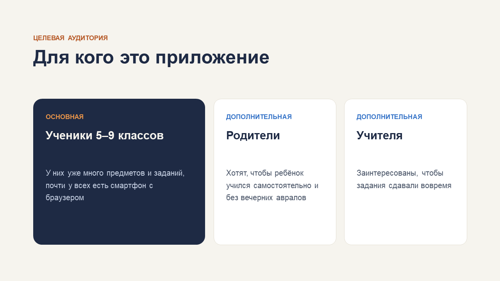 |
| 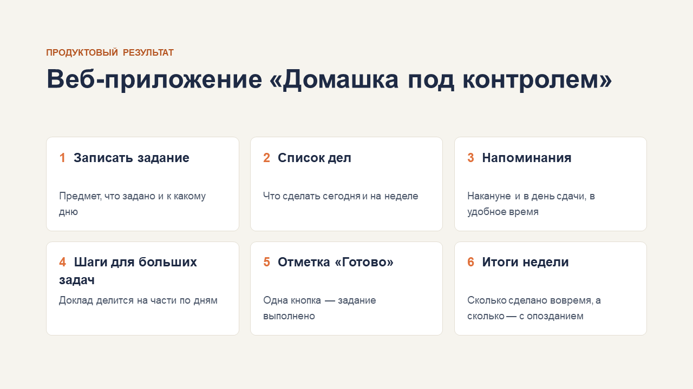 | 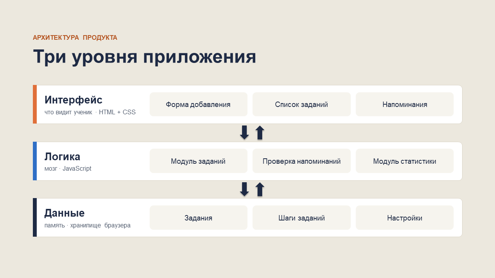 |
| 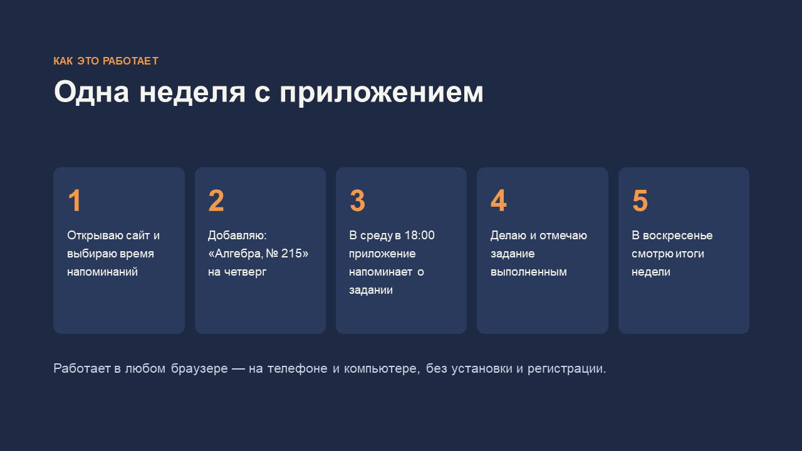 | 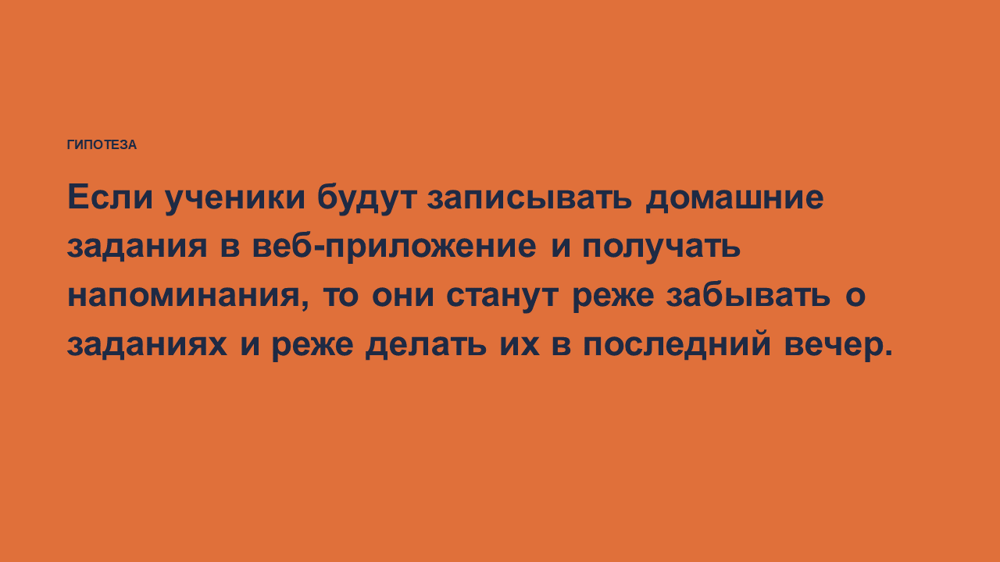 |
| 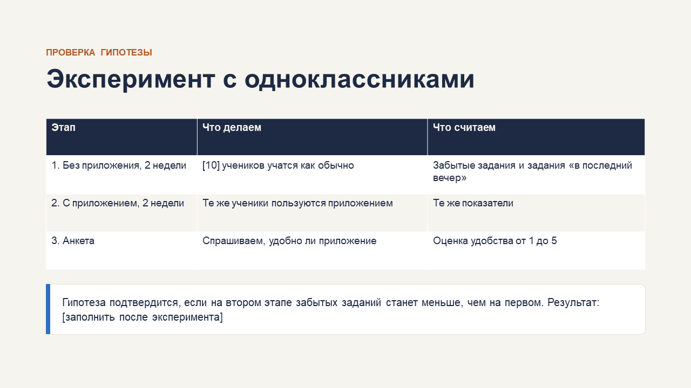 | 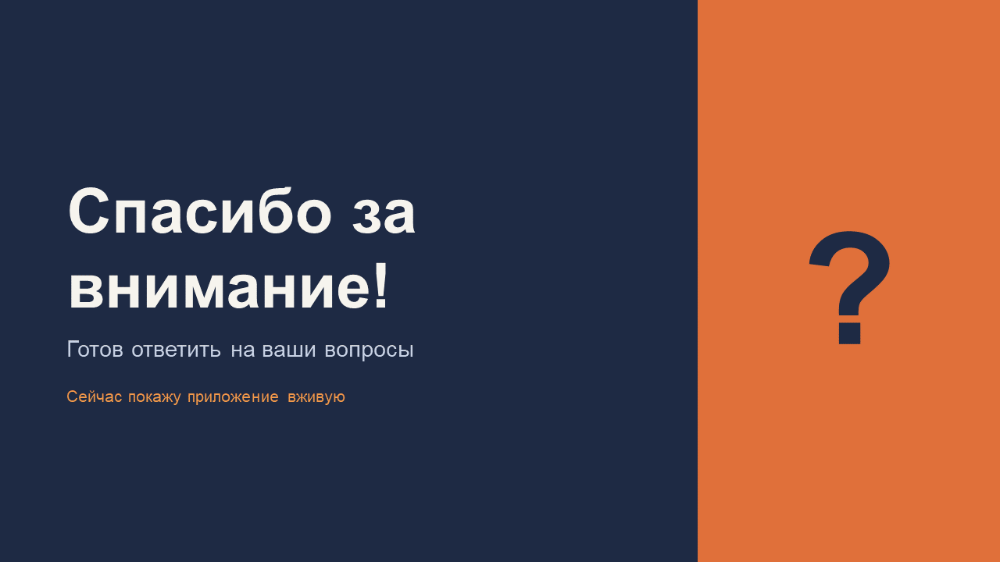 |

---

## Как запустить у себя
- **Онлайн:** откройте https://komissar-dev.github.io/Dzhasimov-homework/
- **Без интернета:** скачайте репозиторий (**Code → Download ZIP**), распакуйте и откройте `index.html` в браузере.

Задания хранятся только в браузере того устройства, где их ввели. На сервер ничего не отправляется.

## Структура репозитория
```
index.html        — страница приложения
style.css         — оформление
js/logic.js       — логика (сроки, напоминания, статистика)
js/storage.js     — хранение данных в браузере
js/app.js         — работа интерфейса
manifest.json     — установка на телефон
sw.js             — офлайн-режим и уведомления
icons/            — иконки приложения
docs/             — презентация, доклад, инструкция по тестированию, слайды
```
